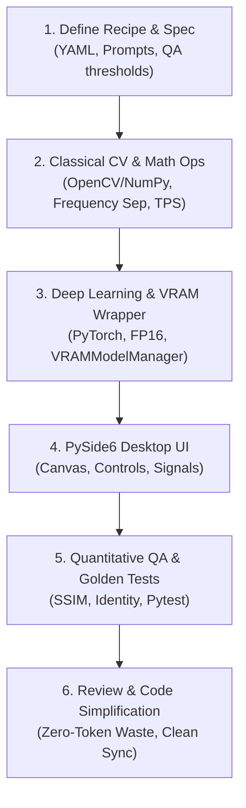

# Photo AI Desktop SDLC Workflow (Quy Trình Vòng Đời Tính Năng)

Chu trình phát triển tính năng / recipe mới cho hệ thống Photo AI Desktop tuân thủ 6 giai đoạn tiêu chuẩn (Define → Plan → Build → Verify → Review → Ship):

## Giai đoạn 1: Đặc tả Nghiệp vụ & Recipe (Recipe & Spec Definition)
- Định nghĩa Recipe ID trong `recipes/<id>.yaml` tuân thủ nghiêm ngặt `RecipeSchema`.
- Khai báo detectors yêu cầu (`face_analyzer`, `bisenet`, `ocr`, `product_matting`...).
- Thiết lập thông số xử lý (`strength`, `blend_mode`, `feather_radius`, `hf_restore_strength`).
- Xác lập bộ ngưỡng QA bắt buộc (`qa.thresholds`): `identity_min`, `ssim_min`, `ear_min`, `texture_variance_min`, `delta_e_max`.
- Viết 2 file prompt đặc tả: `prompts/<id>.vi.md` và `prompts/<id>.en.md`.

## Giai đoạn 2: Thuật Toán Thị Giác Máy Tính Cổ Điển (Classical CV Ops)
- Viết module toán học/OpenCV thuần trong `src/photoai/processors/cv_ops/`.
- Tiêu chí: Thuật toán tất định (deterministic), không ảo giác, bảo tồn texture da gốc.
- Đảm bảo có nhánh Classical CV fallback độc lập ngay cả khi không có GPU hoặc khi thiếu model weights.
- Viết unit test toán học tương ứng trong `tests/unit/test_cv_ops.py`.

## Giai đoạn 3: Tích hợp Model Học Sâu & Quản Lý VRAM (AI Wrapper & GPU Pipeline)
- Hiện thực wrapper trong `src/photoai/processors/ai_wrappers/`.
- Mọi model nạp qua `VRAMModelManager.get_model(key, loader_fn)`.
- Áp dụng kỹ thuật:
  - FP16/BF16 nửa độ chính xác trên CUDA/MPS.
  - Tiled processing (chia ô nhỏ kèm overlap) đối với ảnh siêu phân giải 4K để chống OOM.
  - Tự động offload model cũ khi số lượng vượt quá `max_active_models = 2`.

## Giai đoạn 4: Giao Diện Desktop PySide6 (UI & Interactive Tools)
- Bổ sung công cụ vào `ToolSelector` và cập nhật danh mục sidebar.
- Nếu chức năng cần vẽ vùng chọn (ví dụ: inpainting, watermark), kích hoạt chế độ cọ vẽ mask trên `InteractiveCanvas`.
- Nếu chức năng có tính nhạy cảm bản quyền, bật `WatermarkDialog` để xác nhận quyền trước khi chạy.
- Kết nối `PipelineWorker` qua `QThread` đảm bảo 100% không giật lag giao diện.

## Giai đoạn 5: Kiểm Thử Định Lượng & Golden Verification
- Viết kiểm thử đơn vị (`tests/unit/`).
- Thêm kịch bản kiểm thử tích hợp vào `tests/integration/test_all_recipes.py`.
- Chạy toàn bộ test suite qua lệnh: `python -m pytest tests/ -q`.
- Kiểm tra chạy offscreen của giao diện: `python main.py --self-check`.

## Giai đoạn 6: Rà Soát Chất Lượng & Đồng Bộ Mã Nguồn
- Kiểm tra 5 trục chất lượng: Tính chính xác, An toàn VRAM, Tính bất biến ảnh gốc, Chuẩn giao diện PySide6, Đơn giản hóa mã nguồn.
- Kiểm tra hỗ trợ định dạng ảnh (đặc biệt JFIF) và bảo đảm luôn xuất PNG hoặc JPG.
- Chạy `codegraph sync` để cập nhật cơ sở tri thức đồ thị.
