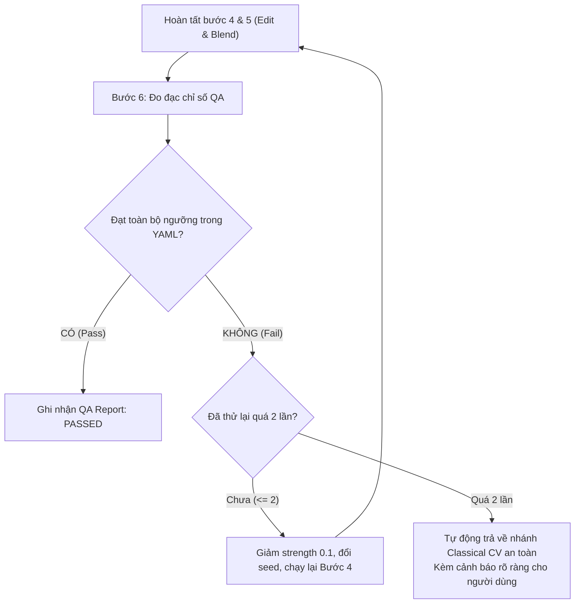

# QA Metrics & Evaluation Skill (Đo Lường Chất Lượng Định Lượng)

Kỹ năng tính toán các thước đo khách quan trong xử lý ảnh, bảo đảm mọi bức ảnh thành phẩm đều đạt chuẩn công nghiệp trước khi bàn giao cho người dùng.

## 1. Bảng Chỉ Số Đo Lường Toán Học (`src/photoai/qa/metrics.py`)

| Tên Chỉ Số | Phạm vi giá trị | Mục tiêu & Ý nghĩa nghiệp vụ |
|---|---|---|
| `identity_cosine` | $[0.0, 1.0]$ | Độ tương đồng đặc trưng khuôn mặt (ArcFace). Bắt buộc $\ge 0.95$ (hoặc $\ge 0.88$ khi phục hồi ảnh cũ nát) để chống đổi mặt người khác. |
| `ssim` | $[0.0, 1.0]$ | Độ tương đồng cấu trúc hình ảnh (Structural Similarity). Kiểm soát việc giữ nguyên hậu cảnh ngoài vùng mask. |
| `ear` (Eye Aspect Ratio) | $[0.0, 0.5]$ | Tỷ lệ mở mắt. Bắt buộc mắt sau khi mở phải đạt $\ge 0.22$ để không bị cảm giác mắt lờ đờ hoặc giả tạo. |
| `delta_e_skin` | $[0.0, \infty)$ | Chênh lệch màu da trong không gian CIELAB. Ngưỡng $\le 1.8$ đảm bảo làm mịn da không làm biến đổi tông màu tự nhiên. |
| `texture_variance` | $[0.0, \infty)$ | Độ phương sai kết cấu qua toán tử Laplacian. Đảm bảo lỗ chân lông không bị xóa sổ ($\ge 70\%$ so với ảnh gốc). |
| `clip_ratio` | $[0.0, 1.0]$ | Tỷ lệ pixel bị cháy sáng (255) hoặc mất chi tiết vùng tối (0). Ngưỡng $< 1\%$ để bảo toàn dynamic range. |

## 2. Quy Trình Đánh Giá & Tự Động Fallback (`evaluator.py` & `runner.py`)

## 3. Nguyên Tắc Cân Chỉnh Ngưỡng
- Ngưỡng QA không được phỏng đoán mà phải dựa trên dữ liệu đo lường thực tế từ bộ ảnh kiểm thử (`tests/golden/`).
- Đối với các tác vụ thay đổi kích thước toàn ảnh (như `upscale_4k`), không gate `ssim` trực tiếp mà gate `ssim_downscaled` hoặc `structure_similarity`.
