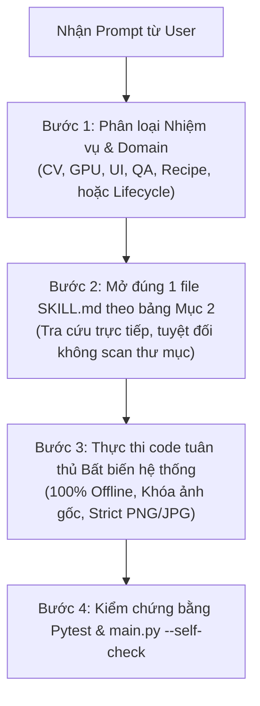

# BẢN ĐỒ ĐIỀU HƯỚNG SKILL & GIAO THỨC TỐI ƯU HÓA TOKEN (PHOTO AI DESKTOP AGENT ROUTING)

> **Dành cho mọi AI Coding Agent hoạt động trong dự án Photo AI Desktop (Local GPU Edition)**  
> **Phiên bản:** 3.0 | **Tiêu chuẩn:** [Addy Osmani Agent Skills](https://github.com/addyosmani/agent-skills) & [VoltAgent Awesome Agent Skills](https://github.com/VoltAgent/awesome-agent-skills)  
> **Trạng thái an toàn mã nguồn:** :white_check_mark: **100% OFFLINE & LOCAL GPU** (0 Cloud API, 0 telemetry, 0 rò rỉ dữ liệu, 0 CUDA OOM)

---

## 1. NGUYÊN TẮC VÀNG TỐI ƯU HÓA TOKEN (ZERO-TOKEN-WASTE PROTOCOL)

Khi làm việc trong dự án Photo AI Desktop, context window là tài nguyên quý giá. Mọi Agent **BẮT BUỘC** tuân thủ 4 nguyên tắc sau:

### :no_entry_sign: 1. Tuyệt đối KHÔNG quét / liệt kê thư mục bừa bãi (No Directory Sprawling)
- **CẤM:** Chạy `Get-ChildItem -Recurse`, `find .`, `ls -R`, hoặc dùng công cụ xem danh sách thư mục `.agents/` khi tìm kiếm skill.
- **CHUẨN:** Nhìn vào **Bảng tra cứu Ma trận (Mục 2)** bên dưới, lấy chính xác đường dẫn file `SKILL.md` và mở trực tiếp bằng công cụ xem file.

### :dart: 2. Nạp Lũy Tiến & Đích Danh (Single Skill Targeted Loading)
- Mỗi tác vụ chỉ mở duy nhất **1 file `SKILL.md`** đại diện cho nhiệm vụ cốt lõi.
- Chỉ mở thêm file thứ 2 khi có sự kết hợp đặc thù (ví dụ: làm UI canvas cần `pyside6-desktop-engineering` kết hợp `canvas-and-interactive-tools`).
- **CẤM:** Không đọc đồng thời nhiều hơn 2 skill trong một phiên làm việc.

### :octagonal_sign: 3. Chặn Nạp Thư Mục Con Nặng (Subfolder Blacklist)
- `tests/golden/` (Chứa ảnh nhị phân mẫu test).
- `models_weights/` (Chứa file weights lớn `.pth`, `.safetensors`, `.onnx`).
- `.codegraph/` (Chứa cơ sở dữ liệu đồ thị, chỉ truy vấn qua công cụ `codegraph_explore` / `codegraph explore`).

### :pushpin: 4. Đọc Theo Phạm Vi Dòng (Slice Reading)
- Khi một file dài hơn 200 dòng, dùng tham số `StartLine` và `EndLine` để chỉ lấy đúng phần hướng dẫn cần thiết thay vì nuốt toàn bộ file.

---

## 2. BẢNG ĐIỀU HƯỚNG TỔNG THỂ SKILLS THEO NGHIỆP VỤ (MASTER ROUTING MATRIX)

> **Quy ước đường dẫn:** Tất cả skills được chuẩn hóa tại:  
> `[.agents/skills/<domain>/<skill-name>/SKILL.md](file:///C:/O%20E/Blueprint/.agents/skills/<domain>/<skill-name>/SKILL.md)`

---

### 2.1 Lĩnh Vực Thị Giác Máy Tính & Học Sâu Cục Bộ (CV & Local AI)

| Tình huống / Nhiệm vụ trong Prompt | Skill điều hướng chuẩn | Đường dẫn truy cập trực tiếp | Ghi chú tiết kiệm token |
|---|---|---|---|
| Nạp ảnh đa định dạng (đặc biệt JFIF, WebP, TIFF), xoay EXIF, chuẩn hóa sRGB/CMYK, xuất PNG/JPG | **image-codec-and-color-science** | [.agents/skills/domain-cv-ai/image-codec-and-color-science/SKILL.md](file:///C:/O%20E/Blueprint/.agents/skills/domain-cv-ai/image-codec-and-color-science/SKILL.md) | Nắm quy tắc luôn xuất PNG/JPG |
| Tách tần số giữ lỗ chân lông da, biến dạng lưới TPS chỉnh nọng cằm, cân bằng màu LAB, bóng studio | **computer-vision-engineering** | [.agents/skills/domain-cv-ai/computer-vision-engineering/SKILL.md](file:///C:/O%20E/Blueprint/.agents/skills/domain-cv-ai/computer-vision-engineering/SKILL.md) | Tập trung vào 4 thuật toán trong `cv_ops` |
| Quản lý VRAM GPU, PyTorch FP16/BF16, nạp/xả model tối đa 2 cái, chống tràn CUDA OOM | **gpu-vram-pipeline** | [.agents/skills/domain-cv-ai/gpu-vram-pipeline/SKILL.md](file:///C:/O%20E/Blueprint/.agents/skills/domain-cv-ai/gpu-vram-pipeline/SKILL.md) | Tra cứu `VRAMModelManager` và cơ chế eviction |
| Cấu hình weights ngoại tuyến, nạp weights Real-ESRGAN, LaMa, CodeFormer, BiSeNet, BiRefNet | **model-loader-and-weights** | [.agents/skills/domain-cv-ai/model-loader-and-weights/SKILL.md](file:///C:/O%20E/Blueprint/.agents/skills/domain-cv-ai/model-loader-and-weights/SKILL.md) | Dùng hàm `register_model_loader` |

---

### 2.2 Lĩnh Vực Giao Diện Máy Tính PySide6 (Desktop UI & Canvas)

| Tình huống / Nhiệm vụ trong Prompt | Skill điều hướng chuẩn | Đường dẫn truy cập trực tiếp | Ghi chú tiết kiệm token |
|---|---|---|---|
| Thiết kế cửa sổ Desktop, QThread non-blocking, Qt Signals/Slots, Dark Mode QSS, kéo thả ảnh | **pyside6-desktop-engineering** | [.agents/skills/domain-ui/pyside6-desktop-engineering/SKILL.md](file:///C:/O%20E/Blueprint/.agents/skills/domain-ui/pyside6-desktop-engineering/SKILL.md) | Đọc cơ chế Worker Thread |
| Khung vẽ đồ họa 4K, lăn chuột zoom/pan mượt mà, cọ vẽ mask bán trong suốt, thanh so sánh Trước/Sau | **canvas-and-interactive-tools** | [.agents/skills/domain-ui/canvas-and-interactive-tools/SKILL.md](file:///C:/O%20E/Blueprint/.agents/skills/domain-ui/canvas-and-interactive-tools/SKILL.md) | Đọc logic vẽ overlay NumPy |

---

### 2.3 Lĩnh Vực Đảm Bảo Chất Lượng & Tuân Thủ Đạo Đức (QA, QC & Ethics)

| Tình huống / Nhiệm vụ trong Prompt | Skill điều hướng chuẩn | Đường dẫn truy cập trực tiếp | Ghi chú tiết kiệm token |
|---|---|---|---|
| Đo đạc SSIM, ArcFace Cosine, EAR mở mắt, Delta-E da, Texture Variance, cơ chế tự động fallback | **qa-metrics-and-evaluation** | [.agents/skills/domain-qa/qa-metrics-and-evaluation/SKILL.md](file:///C:/O%20E/Blueprint/.agents/skills/domain-qa/qa-metrics-and-evaluation/SKILL.md) | Tra cứu bảng công thức số học |
| Hộp thoại xác nhận bản quyền khi xóa watermark, nhật ký kiểm toán SQLite, bảo mật 100% offline | **security-and-audit-logs** | [.agents/skills/domain-qa/security-and-audit-logs/SKILL.md](file:///C:/O%20E/Blueprint/.agents/skills/domain-qa/security-and-audit-logs/SKILL.md) | Kiểm tra `audit_logs` table |

---

### 2.4 Lĩnh Vực Công Thức Chỉnh Ảnh Nghiệp Vụ (Recipes & Business Specs)

| Tình huống / Nhiệm vụ trong Prompt | Skill điều hướng chuẩn | Đường dẫn truy cập trực tiếp | Ghi chú tiết kiệm token |
|---|---|---|---|
| Cấu trúc dữ liệu 10 recipes, kiểm tra schema YAML, prompt song ngữ Việt/Anh, định tuyến editor | **photo-recipe-engineering** | [.agents/skills/domain-recipes/photo-recipe-engineering/SKILL.md](file:///C:/O%20E/Blueprint/.agents/skills/domain-recipes/photo-recipe-engineering/SKILL.md) | Đọc mẫu YAML schema |

---

### 2.5 Vòng Đời Kỹ Thuật Chuẩn Cao Cấp (Core Engineering Lifecycle)

> Phỏng theo tiêu chuẩn của **Addy Osmani** (`DEFINE → PLAN → BUILD → VERIFY → REVIEW → SHIP`)

| Giai đoạn vòng đời | Command tương đương | Skill điều hướng chuẩn | Đường dẫn truy cập trực tiếp |
|---|---|---|---|
| **Define (Đặc tả)** | `/spec` | **spec-driven-development** | [.agents/skills/core-lifecycle/spec-driven-development/SKILL.md](file:///C:/O%20E/Blueprint/.agents/skills/core-lifecycle/spec-driven-development/SKILL.md) |
| **Plan (Kế hoạch)** | `/plan` | **planning-and-task-breakdown** | [.agents/skills/core-lifecycle/planning-and-task-breakdown/SKILL.md](file:///C:/O%20E/Blueprint/.agents/skills/core-lifecycle/planning-and-task-breakdown/SKILL.md) |
| **Build (Thực thi)** | `/build` | **incremental-implementation** | [.agents/skills/core-lifecycle/incremental-implementation/SKILL.md](file:///C:/O%20E/Blueprint/.agents/skills/core-lifecycle/incremental-implementation/SKILL.md) |
| **Verify (Kiểm thử)** | `/test` | **test-driven-development** | [.agents/skills/core-lifecycle/test-driven-development/SKILL.md](file:///C:/O%20E/Blueprint/.agents/skills/core-lifecycle/test-driven-development/SKILL.md) |
| **Review (Rà soát)** | `/review` | **code-review-and-quality** | [.agents/skills/core-lifecycle/code-review-and-quality/SKILL.md](file:///C:/O%20E/Blueprint/.agents/skills/core-lifecycle/code-review-and-quality/SKILL.md) |
| **Simplify (Tinh gọn)** | `/code-simplify` | **code-simplification** | [.agents/skills/core-lifecycle/code-simplification/SKILL.md](file:///C:/O%20E/Blueprint/.agents/skills/core-lifecycle/code-simplification/SKILL.md) |
| **Debug (Sửa lỗi)** | N/A | **debugging-and-error-recovery** | [.agents/skills/core-lifecycle/debugging-and-error-recovery/SKILL.md](file:///C:/O%20E/Blueprint/.agents/skills/core-lifecycle/debugging-and-error-recovery/SKILL.md) |

---

## 3. QUY TRÌNH 3 BƯỚC THỰC THI NHANH CHO MỌI AGENT

